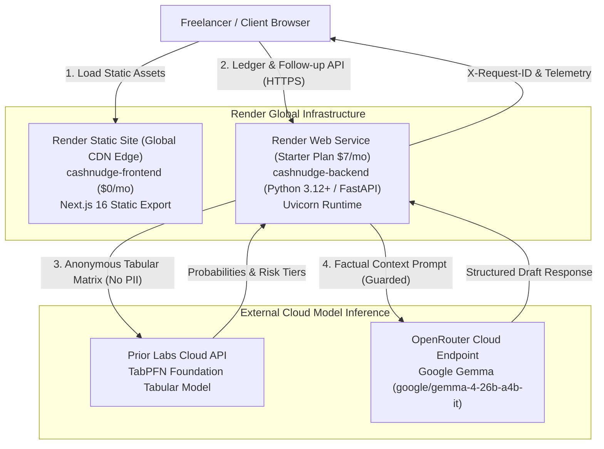

# CashNudge — Hacktoberfest: Best Use of Render Submission Guide

> **Project:** CashNudge — AI-Powered Invoice Risk & Payment Follow-Up Assistant  
> **Tagline:** *"Know the risk. Nudge the payment."*  
> **Category:** Hacktoberfest — Best Use of Render  

---

## 1. Executive Summary & Why Render is the Central AI Runtime

CashNudge solves a critical cash-flow problem for freelancers and solo agencies: early intelligence on late-payment risk and relationship-preserving follow-up reminders.

Rather than building a monolithic application or relying on fragile serverless functions with cold-start penalties, CashNudge utilizes **Render as the central AI application coordinator and runtime**:



### The Cost-Optimized Hybrid Architecture
With a $50 Render credit allocation, CashNudge is engineered for maximum operational efficiency:
1. **Frontend on Render Static Site (`type: static`):**
   * Pre-rendered static export (`output: "export"`) served across Render's global CDN edge.
   * **Monthly Cost: $0.00** (Free forever, unlimited bandwidth, instant global page loads, zero cold-starts).
2. **Backend on Render Web Service (`type: web` — Starter Plan):**
   * 24/7 dedicated container with 512 MB RAM and 0.5 CPU.
   * **Monthly Cost: $7.00/month**.
   * **Sustainability:** The $50 credit provides **over 7 months of continuous, uninterrupted production operation**.

---

## 2. Render as the AI Security & Coordination Runtime

Render does not merely serve HTML; it acts as the authoritative security, privacy, and intelligence gateway:

1. **Privacy Boundary & PII Stripping:**
   * Customer names (`client_name`), invoice identifiers (`invoice_id`), and due dates are stripped before tabular feature matrices are passed to TabPFN.
   * No confidential invoice records or customer data are ever logged or saved to persistent disk on the Render container.
2. **Factual Grounding & Prompt Assembly:**
   * The Render backend pre-calculates deterministic date facts (e.g. days overdue vs days until due against explicit reference dates).
   * Verified facts and strict anti-hallucination directives are assembled in-memory before reaching Gemma.
3. **Abuse Protection & Rate Limiting:**
   * Built-in sliding-window rate limiter protects downstream AI inference costs against unauthorized spam.
4. **Transparent Observability:**
   * Every request receives an `X-Request-ID` header.
   * Structured latency and status telemetry are emitted to Render log streams without logging request bodies or sensitive financial details.

---

## 3. Concrete Evidence Checklist for the DEV Post

When publishing the Hacktoberfest DEV post, include the following verified artifacts:

### A. Live URLs
* **Frontend Application:** `https://cashnudge-frontend.onrender.com` *(Fill with live URL)*
* **Backend API Health Check:** `https://cashnudge-backend.onrender.com/health` *(Fill with live URL)*
* **Interactive OpenAPI Docs:** `https://cashnudge-backend.onrender.com/docs`

### B. Render Service Configuration Evidence
* Screenshot of Render Dashboard showing two deployed services:
  1. `cashnudge-frontend` (Static Site — Green / Live)
  2. `cashnudge-backend` (Web Service — Starter / Live)
* The declarative [`render.yaml`](file:///c:/Users/ACER/Downloads/CashNudge/render.yaml) Blueprint in the GitHub repository.

### C. Live Deployed Request Evidence
Include sample curl commands and output against the live Render endpoint:

#### 1. Service Health Check (`GET /health`)
```bash
curl -i https://cashnudge-backend.onrender.com/health
```
*Expected Response:*
```http
HTTP/1.1 200 OK
content-type: application/json
x-request-id: req_a1b2c3d4

{
  "status": "healthy",
  "service": "CashNudge API",
  "version": "0.1.0",
  "providers": {
    "tabpfn_mode": "hosted_cloud",
    "gemma_mode": "hosted"
  }
}
```

#### 2. Tabular Risk Analysis (`GET /api/v1/ledger/sample`)
Demonstrating real TabPFN probability stratification:
```json
{
  "summary": {
    "total_invoices": 24,
    "historical_invoices_count": 18,
    "outstanding_invoices_count": 6,
    "total_outstanding_amount": 42000.0,
    "at_risk_amount": 31500.0,
    "high_risk_amount": 24700.0
  },
  "predictions": [
    {
      "invoice_id": "INV-2024-020",
      "client_name": "Terraform Spatial",
      "invoice_amount": 6800.0,
      "payment_terms_days": 30,
      "late_probability": 0.2841,
      "risk_tier": "low",
      "due_date": "2026-10-24",
      "due_status": "upcoming"
    }
  ]
}
```

#### 3. Real Gemma Neural Follow-Up Generation (`POST /api/v1/followups/draft`)
Demonstrating real model attribution (`Provider: Gemma (Hosted: google/gemma-4-26b-a4b-it)`):
```json
{
  "invoice_id": "INV-2024-020",
  "customer_name": "Terraform Spatial",
  "tone": "gentle",
  "drafted_message": "Subject: Friendly check-in regarding invoice INV-2024-020\n\nHi Terraform Spatial team,\n\nI hope you're having a productive week.\n\nThis is a gentle reminder that invoice INV-2024-020 for the Cloud & DevOps Architecture deliverable ($6,800.00) is scheduled for payment on October 24, 2026.\n\nPlease let me know if you need any additional project paperwork.\n\nBest regards,\nStudio North",
  "inference_provider": "Gemma (Hosted: google/gemma-4-26b-a4b-it)",
  "human_approval_required": true,
  "date_facts": {
    "status": "upcoming",
    "days_until_due": 6
  }
}
```

---

## 4. Technical Constraints & Honest Model Card Disclosure

* **Inference Runtime Location:** Render provides the high-performance Python application runtime, request routing, rate limiting, and web serving. Model weights for TabPFN are hosted on Prior Labs dedicated inference clusters, and Gemma weights are served via OpenRouter infrastructure.
* **Deterministic Fallback Transparency:** If external API keys are unavailable, CashNudge falls back to deterministic local baseline providers that are explicitly labeled (`MockTabPFN`, `MockGemmaProvider`). In production with configured keys, runtime failures return actionable HTTP error codes (502/503/504/429) rather than silent unlabelled mock substitution.
